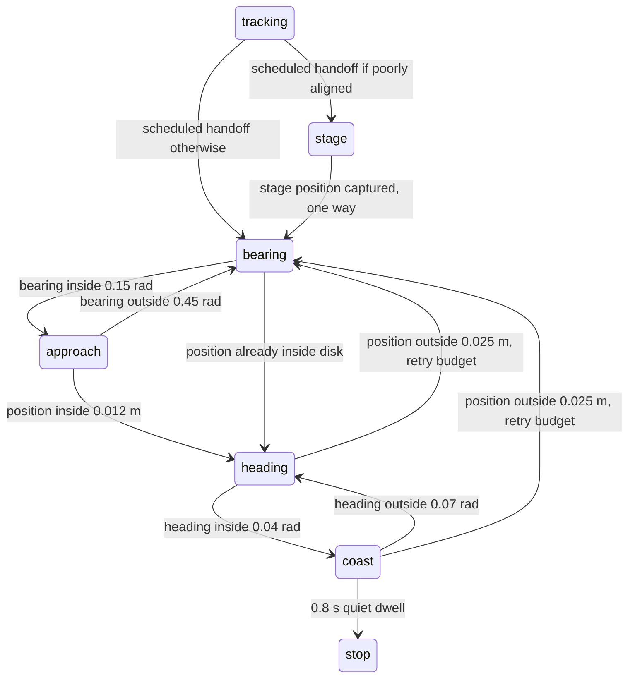

# Part D extension — hybrid terminal pose control

**IDEAL-STATE DIAGNOSTIC ONLY.** This work adds pose-input controllers and an
explicit trajectory/terminal supervisor. The unchanged LQR, its stationary-stop
policy, original Part D results, Part A evidence, ROBOTIS models, meshes and licence
remain the baselines. No camera, LiDAR or EKF code is modified. Ground-truth pose
is used by these diagnostic harnesses; it is not an assessed navigation pipeline.

## Scope and safety assumptions

The local controller bounds motion, slows near the goal, monitors sampled rest,
limits retries/time, and latches zero commands on stop/fault. This is not certified
safety, collision avoidance, ArUco docking or estimated-state integration. It assumes
an externally verified free manoeuvring area. The staged revision additionally
requires space 0.12 m behind the goal and the swept robot footprint along its path.
No obstacle clearance is inferred from goal errors or the overshoot metrics.

The final implementation must receive timestamped EKF pose, in the same world
frame, metres/radians and wheel-axis-midpoint body origin. Call at a fixed 20 Hz;
pose increments estimate rest. No simulator wheel speed is fed into these
controllers. Pose noise, timestamp loss, covariance-aware tolerances and
localisation faults need separate validation. The supervisor rejects decreasing
or nonfinite time, but does not detect missed or duplicate samples; a production
adapter must reject stale samples and stop on callback/estimator exceptions.
The success dwell is only meaningful with fresh fixed-period samples.

## Why stationary LQR is insufficient

For reference-minus-actual body errors, the unchanged LQR uses

```math
A=\begin{bmatrix}0&\omega_r&0\\-\omega_r&0&v_r\\0&0&0\end{bmatrix},\qquad
B=\begin{bmatrix}-1&0\\0&0\\0&-1\end{bmatrix}.
```

At v_r=omega_r=0, rank[B AB A²B]=2. Lateral error is an uncontrollable integrator;
the stationary linearisation is not fully stabilisable. The nonlinear unicycle
can change lateral position through rotations and translations, so a hybrid
manoeuvre can complement the trajectory tracker. No artificial moving reference
is inserted to disguise stationary rank loss. The original `stationary_stop`
behaviour remains untouched for paired comparison.

## Direct hybrid derivation

Let rho=||p_g-p||, bearing error alpha=wrap(atan2(y_g-y,x_g-x)-theta), and final
heading error e_h=wrap(theta_g-theta). Positive yaw is anticlockwise, heading
errors wrap through atan2(sin,cos), and translation is forward-only. When rho is
outside the position disk, exact planar kinematics give

```math
\dot\rho=-v\cos\alpha,\qquad
\dot\alpha=\frac v\rho\sin\alpha-\omega.
```

Avoid the bearing singularity at rho=0 by switching to heading control inside a
nonzero position disk. In `bearing`, command v=0 and
omega=clip(k_alpha alpha, -omega_max, omega_max). Under ideal kinematics the
bearing error decreases. Switch to `approach` when |alpha|≤0.15 rad; switch back
only when |alpha|≥0.45 rad. In approach use

```math
v=\min(v_{max},k_\rho\rho)\max(0,\cos\alpha),\qquad
\omega=\operatorname{clip}(k_\alpha\alpha,-\omega_{max},\omega_{max}).
```

For |alpha|<0.45, rho_dot=-min(v_max,k_rho rho)cos²(alpha)<0. With k_alpha=2 and
k_rho=0.8, the unsaturated angular law decreases |alpha| because
|cos(alpha)sin(alpha)|≤|alpha|. In the angularly saturated part of this interval,
|(v/rho)sin(alpha)|≤k_rho/2=0.4<omega_max=0.6, so angular correction retains its
sign. This is an ideal continuous kinematic argument, not a proof under contact,
actuator lag, sampled updates or disturbances. Position speed falls continuously
with distance; no artificial minimum wheel speed or friction cancellation is used.

When rho≤0.012 m, latch `heading`: v=0 and
omega=clip(2 e_h, -0.6, 0.6). Ideal kinematics keep position constant while
heading error decreases. In MuJoCo, turning can translate the base. If position
leaves 0.025 m during heading/coast, re-enter bearing; permit at most three such
re-approaches, then latch `fault`. This prevents unlimited cycling.

Enter `coast` at |e_h|≤0.04 rad and send zero commands. Return to heading only
if |e_h|>0.07 rad; retain zero in the hysteresis band. Restart approach if position
exits its outer disk. Require 0.8 s of consecutive zero-command samples with
rho≤0.025 m, |e_h|≤0.07 rad, observed translation speed≤0.008 m/s and yaw
rate≤0.04 rad/s. Then latch `stop`. Observed rates are computed from consecutive
pose samples, not privileged MuJoCo velocity. Stop never automatically reactivates:
a new task/disturbance requires explicit supervisory handling and a new instance.
Invalid pose or a 45 s terminal timeout (within a controller tick) latches fault
and zero commands. The fixed goal cannot silently change during a manoeuvre.

## Staged revision and evidence-driven change

The direct hybrid was tested first and all evidence is retained in
[terminal_results](../simulation/terminal_results/RESULTS.md). It failed three
kv=1 scenarios at both timesteps. During large final-heading rotations, base
position drift crossed the outer disk, and repeated direct re-approaches recreated
the same poor arrival heading. Bounded retries correctly stopped these runs;
the direct design was not sufficient for the full diagnostic grid.

The staged revision chooses its manoeuvre once, from the first terminal pose.
If rho>0.025 m and the bearing-to-goal differs from desired final heading by more
than 0.35 rad, use a position-only staging target

```math
p_s=p_g-0.12\begin{bmatrix}\cos\theta_g\\\sin\theta_g\end{bmatrix}.
```

Run the bearing/approach laws to within 0.012 m of p_s. Immediately discard the
stage (without a final-heading rotation there) and run the direct hybrid to the
actual fixed goal. The stage is never reintroduced. At an ideal position-only
stage capture, the final target bearing differs from theta_g by at most
asin(0.012/0.12)≈0.1002 rad. Rotating towards it at the staging point therefore
leaves most heading correction away from the final goal. Contact drift invalidates
that geometric bound for the real simulated plant, so the full tests remain
necessary. The same 45 s budget covers both stage and final control; a stage
fault also latches zero. Near-goal and already aligned cases omit staging.

This is a practical tolerance controller, not an exact asymptotic smooth static
pose stabiliser. The hybrid discontinuities, nonzero disks and latched stop are
explicit. No global capture region is claimed.

## Supervisor, parameters and feasibility

`TrajectoryTerminalController` wraps the unchanged `LQRTracker`. Before a fixed
reference end time it forwards LQR commands. At/after that time it permanently
hands control to the terminal controller. No distance-triggered switch back to
tracking is permitted. `StagedTrajectoryTerminalController` changes only the
terminal dependency. Handoff is scheduled, not an actuator-aware optimal braking
trajectory; abrupt changes in wheel commands remain possible. The terminal law
reduces speed near the goal but imposes no acceleration/jerk limit.



Fault exits from every active terminal mode apply on invalid pose, timeout or
retry exhaustion; stop/fault latch. The stage internally uses bearing/approach.

| Parameter | Value | Interpretation |
|---|---:|---|
| Controller interval | 0.05 s | Same as baseline LQR |
| Distance gain | 0.8 s⁻¹ | Approach speed reduction |
| Bearing / heading gains | 2 / 2 s⁻¹ | Turn correction |
| Terminal speed caps | 0.08 m/s, 0.6 rad/s | Conservative commanded motion |
| Position entry / exit | 0.012 / 0.025 m | Capture and drift hysteresis |
| Heading entry / exit | 0.04 / 0.07 rad | Rotation/coast hysteresis |
| Bearing entry / exit | 0.15 / 0.45 rad | Rotate/translate hysteresis |
| Quiet dwell | 0.8 s | Consecutive fresh pose samples |
| Pose-increment rest limits | 0.008 m/s, 0.04 rad/s | Stop qualification |
| Time / retry budgets | 45 s / 3 re-approaches | Fault-stop limits |
| Stage distance / trigger | 0.12 m / 0.35 rad | Final approach geometry |

These are declared engineering parameters and tolerances, not rubric requirements,
physical ground truth or validated docking-clearance requirements. They were
not tuned separately for each gain or timestep. Staging was developed after
observing direct failures on this same grid, so its results are not held-out
generalisation evidence. Future targets/perturbations must be held out.

Both supervisors call the unchanged differential-drive wheel conversion and common
scaling: w_L=(v-0.08 omega)/0.033, w_R=(v+0.08 omega)/0.033, then divide both by
max(1,max|w|/6.67). This preserves turning sign and curvature. The terminal caps
imply max|w|≤(0.08+0.08×0.6)/0.033≈3.88 rad/s, so terminal wheel saturation is
expected to be zero. The LQR tracking prefix can still saturate. These are speed
command limits, not guarantees of actual speed, traction, braking or force safety.
Original XML physical parameters and gains remain unchanged.

## Test design and metric definitions

Each revision executes 80 fresh-state MuJoCo trials: ten scenarios × two gains
(kv=0.1 and 1) × physics timesteps 0.002 and 0.001 s × two strategies (hybrid,
unchanged stationary stop). Thus 160 runs were executed, including 40 repeated
stationary baseline runs; the repeated baselines are byte-identical across the
revisions. This is deterministic repetition, not stochastic replication.

Eight direct-to-origin initial poses are: (-0.20,0,0), (0.15,0,0), (0,0.15,-1),
(-0.15,-0.10,pi), (0,0,1.2), (0.06,-0.06,-pi+0.02), (0.015,0.005,-0.15), and
(0,0,0). They include goals behind/lateral, opposed heading, heading-only, near
tolerance and already achieved target cases. Two additional scenarios track the
existing straight and waypoint trajectories from (-0.08,0.06,0.2), then hand off
to their endpoint poses. The already achieved target is an explicit negative
control; do not count its success as error correction.

Every trial settles for 2 s with zero commands before its first logged pose.
Tracking prefixes, initial state, models and end time are identical within each
strategy pair. No state is teleported at handoff. Terminal observations continue
for 50 s after handoff, including timeout/stop and subsequent passive drift.
Measurements include 20 Hz pose, pose increments, goal errors, commanded/measured
wheel speed and mode. Original models, licence/assets, earlier results, controller,
trajectory, movement script and tests are hashed before/after runs.

Final position is Euclidean goal error; heading is wrapped signed error. Settling
time is measured from handoff: the earliest sample within 0.025 m, 0.07 rad and
the rest-rate limits that remains within all bounds through the horizon for at
least 2 s. No such interval means failure; missing settling times stay blank.
All successful hybrids additionally ended in latched stop, verified by the checker.
Fault-stops are not reported as successful control. Settling and supervisor stop
time differ (capture dwell and post-capture motion); both are stored. Means over
successes exclude failures and are explicitly labelled; error means include all
trials. No confidence intervals are justified by this deterministic grid.

Full-terminal goal-plane excursion is max(0,(p-p_g)·d), with d pointing from the
handoff position to the goal. It measures passage beyond that plane, not the
whole swept path. It is undefined geometrically at zero initial distance and is
recorded as zero by convention there. Staging intentionally crosses this plane in
some cases, so it cannot be called only dynamic overshoot. A separate
[geometry analysis](../simulation/terminal_comparison/GEOMETRY.md) fixes a plane
at first non-staging final approach and reports final-approach overshoot.
Heading-phase overshoot is opposite-signed heading error after the first final
heading phase, relative to that phase's initial error sign; it is absent if no
heading phase occurs. None of these scalar metrics bounds lateral drift or
obstacle clearance. All commanded saturation frequencies exclude tracking prefixes
and the unused terminal sample; frequency is over applied terminal hold intervals.
Mode switches and re-approaches are counted explicitly, with a bounded retry policy.

## Executed results

See [direct hybrid results](../simulation/terminal_results/RESULTS.md),
[staged revision results](../simulation/terminal_staged_results/RESULTS.md),
and their per-trial CSV summaries. All failures and raw logs are retained.

| kv | dt | Strategy | Failures / 10 | Mean final position (m) | Mean absolute heading (rad) | Mean successful settling (s) |
|---:|---:|---|---:|---:|---:|---:|
| 0.1 | 0.002 | Stationary stop | 9 / 10 | 0.087988 | 0.866350 | 0.000 |
| 0.1 | 0.002 | Direct hybrid | 9 / 10 | 0.049953 | 0.782890 | 0.000 |
| 0.1 | 0.002 | Staged hybrid | 9 / 10 | 0.064426 | 0.913631 | 0.000 |
| 1 | 0.002 | Stationary stop | 7 / 10 | 0.082218 | 0.864754 | 0.067 |
| 1 | 0.002 | Direct hybrid | 3 / 10 | 0.016502 | 0.383474 | 4.579 |
| 1 | 0.002 | Staged hybrid | 0 / 10 | 0.011873 | 0.031489 | 9.245 |
| 1 | 0.001 | Stationary stop | 7 / 10 | 0.082367 | 0.864947 | 0.067 |
| 1 | 0.001 | Direct hybrid | 3 / 10 | 0.016723 | 0.402738 | 4.514 |
| 1 | 0.001 | Staged hybrid | 0 / 10 | 0.012157 | 0.031523 | 9.180 |

Low-gain success is only the already-achieved target. Friction and weak velocity
tracking prevent reliable near-goal approach and heading correction. The staging
revision can worsen low-gain mean error, as retained results show; it is not a
universal improvement. No minimum-speed boost was added to conceal this limitation.

For staged kv=1 at 0.002 s, worst final position is 0.017449 m, worst absolute
heading is 0.039643 rad, and worst settling time is 24.95 s (behind-goal case).
All ten trials settle at both timesteps; nine require correction and one begins
at the target. At 0.002 s the largest terminal mode-switch count is six, versus
nine for the direct hybrid; stage is not repeatedly reselected. No hybrid
terminal intervals saturate. The tracking prefixes can still saturate.

Full-terminal plane excursion reaches 0.108880 m for the staged revision versus
0.001183 m for the direct hybrid at kv=1, 0.002 s. This is a real manoeuvring-space
cost, not something to hide as an improvement. Final-approach plane overshoot is
zero on this grid and measured heading-phase overshoot is zero; this reflects
tolerance stopping and the stated directional definitions, not exact arrival or
absence of drift. Additional geometry CSVs retain every case.

Across all staged gain/timestep pairs the largest change in final position-error
norm is 0.001681 m and in signed final heading error is 0.018756 rad. Failure
classification is unchanged by halving the physics timestep. These are scalar
error differences, not a bound on trajectory divergence or numerical convergence.
Only two timesteps were tested. All outcomes remain ideal-state diagnostics.

## Reproduction, checks and interfaces

From the project root using the existing environment:

```sh
.venv/bin/python -m unittest discover -s tests -v
.venv/bin/python simulation/benchmark_terminal.py
.venv/bin/python simulation/benchmark_staged_terminal.py
.venv/bin/python simulation/analyse_terminal.py
.venv/bin/python simulation/check_terminal_results.py
.venv/bin/python simulation/check_lqr_results.py
.venv/bin/python simulation/check_identification.py
```

The two benchmarks write separate new result folders and never regenerate Part A
or baseline Part D evidence. Benchmark metadata includes source/protected SHA256,
versions, initial conditions, gains, timing and controller parameters. The staged
runner substitutes the terminal dependency in memory without editing the original
benchmark or controller files. Re-running the same revision intentionally
regenerates only its own terminal result folder. Standard Python suffices for
headless tests; no passive macOS viewer was used.

Nineteen unit tests passed (eight existing LQR tests, eight direct terminal tests,
three staging tests). They cover ideal kinematic capture, true heading wraparound,
zero-distance bearing avoidance, goals behind the robot, speed reduction, wheel
limits, threshold hysteresis, quiet dwell, stop latch, invalid pose, timeout,
retry exhaustion, coasting drift, one-way tracking/stage transitions and staging
selection. The terminal evidence checker recomputes metrics from all 160 logs,
checks wheel feasibility and stop/fault commands, verifies identical paired
starting/tracking states, bounds observed switching and verifies hashes. All 40
repeated stationary baseline logs match byte for byte. The existing Part A and
Part D evidence checkers also passed. Plots were rendered and visually inspected.

Integration uses a fixed goal and scheduled endpoint:

```python
from control.staged_terminal_controller import StagedTrajectoryTerminalController
supervisor = StagedTrajectoryTerminalController(goal_pose, reference_end_time)
# Called with a fresh timestamped EKF pose at 20 Hz, once integration is validated:
body_command, wheel_command, mode, saturated = supervisor.command(
    estimated_pose, reference_sample, reference_time)
```

The diagnostic harness deliberately substitutes simulator pose at that API and
labels it accordingly. Final assessment feedback must use the approved estimator.

## Remaining work

Validate fresh held-out goals, nonzero target orientations, larger errors and
realistic estimator noise/delay. Introduce explicit freshness/covariance checks,
a disturbance policy after stop, acceleration limits and a collision-checked
staging manoeuvre before deployment. Investigate gain=0.1 friction/servo limits
through a validated actuator-aware design rather than per-trial parameter tricks.
Review tolerances against the actual docking geometry and perception uncertainty.
The staged path may take substantially longer or need unavailable free space.
No ArUco acquisition, obstacle navigation or final docking success is established.

## File inventory

New source/document files:

- `control/terminal_controller.py`: direct hybrid and one-way LQR supervisor.
- `control/staged_terminal_controller.py`: staged revision and supervisor.
- `control/TERMINAL_CONTROL.md`: this derivation, protocol and analysis.
- `simulation/benchmark_terminal.py`: direct hybrid/stationary paired experiments.
- `simulation/benchmark_staged_terminal.py`: staged paired experiments.
- `simulation/check_terminal_results.py`: independent evidence and preservation checks.
- `simulation/analyse_terminal.py`: final-approach geometry analysis.
- `tests/test_terminal.py` and `tests/test_staged_terminal.py`: new unit tests.

New evidence folders: `simulation/terminal_results`,
`simulation/terminal_staged_results` and `simulation/terminal_comparison`.
The only pre-existing file modified in this extension is `README.md`, adding links.
Original LQR/trajectory code, tests, Part A/Part D reports/results, robot models,
licence, assets and movement scripts were preserved; baseline hash checkers passed.
