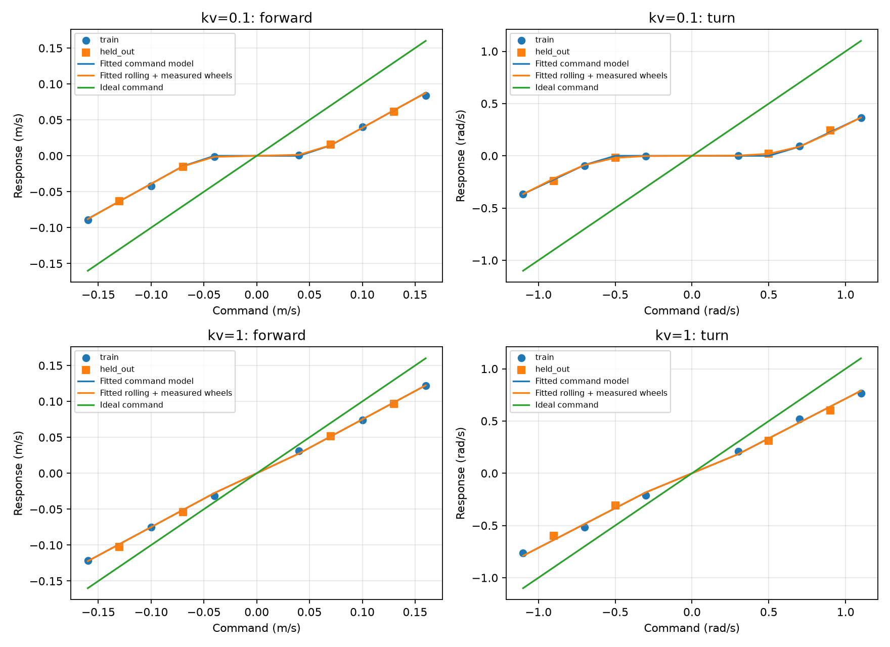
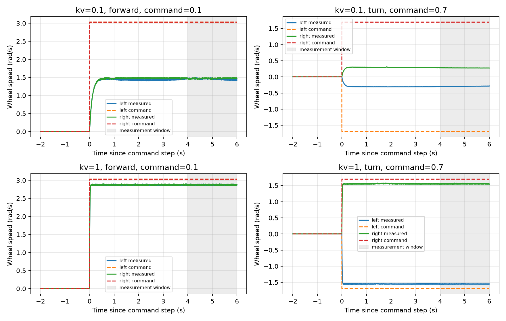
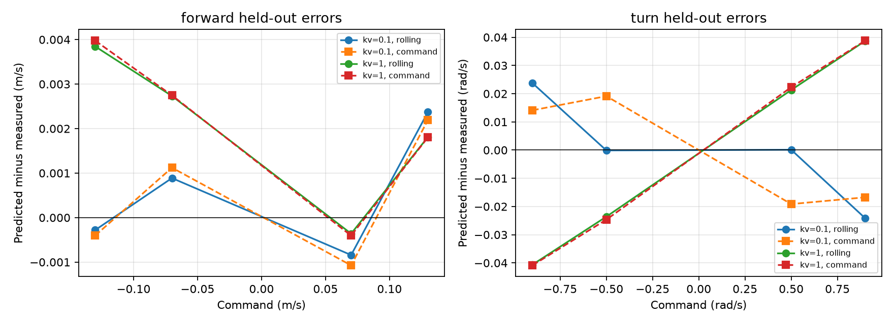

# Part A: executed identification results

Generated by `simulation/identify_drive.py`. Coefficients are empirical finite-window fits, not physical dimensions.

| kv | Mode | Rolling coefficient | Training trial ratio range | Held-out rolling RMSE | Held-out command RMSE | Nominal measured-wheel RMSE | Ideal-command RMSE |
|---:|---|---:|---|---:|---:|---:|---:|
| 0.1 | forward | 0.02660171 | 0.022261–0.028827 | 0.001342 | 0.001359 | 0.011895 | 0.061550 |
| 0.1 | turn | 0.15420659 | 0.147229–0.167242 | 0.016941 | 0.017403 | 0.035550 | 0.575928 |
| 1 | forward | 0.02607352 | 0.025656–0.029723 | 0.002534 | 0.002587 | 0.019873 | 0.024736 |
| 1 | turn | 0.15672537 | 0.151468–0.180081 | 0.032250 | 0.032714 | 0.193016 | 0.251903 |

Forward coefficient units: m/rad; turn coefficient maps wheel-speed difference to yaw rate (dimensionless rad/rad). Forward errors: m/s; turn errors: rad/s.

| kv | Mode | Left slope / deadzone (rad/s) | Right slope / deadzone (rad/s) |
|---:|---|---|---|
| 0.1 | forward | 1.001949 / 1.597576 | 1.018356 / 1.566061 |
| 0.1 | turn | 0.929134 / 1.390667 | 0.934675 / 1.392000 |
| 1 | forward | 1.000230 / 0.157576 | 1.000096 / 0.157576 |
| 1 | turn | 0.998330 / 0.144000 | 0.999084 / 0.144000 |

| kv | Mode | Settled / 10 | Max timestep change in forward speed (m/s) | Max timestep change in yaw rate (rad/s) |
|---:|---|---:|---:|---:|
| 0.1 | forward | 8 / 10 | 0.005729 | 0.065473 |
| 0.1 | turn | 6 / 10 | 0.000255 | 0.003306 |
| 1 | forward | 10 / 10 | 0.011244 | 0.098899 |
| 1 | turn | 10 / 10 | 0.000915 | 0.004224 |

## Per-trial predictions

| kv | Mode | Command | Split | Measured | Rolling prediction | Command prediction | Settled |
|---:|---|---:|---|---:|---:|---:|---|
| 0.1 | forward | -0.04 | train | -0.001167 | -0.001395 | +0.000000 | True |
| 0.1 | forward | +0.04 | train | +0.001167 | +0.001395 | +0.000000 | True |
| 0.1 | forward | -0.07 | held_out | -0.015620 | -0.014732 | -0.014498 | True |
| 0.1 | forward | +0.07 | held_out | +0.015571 | +0.014730 | +0.014498 | True |
| 0.1 | forward | -0.10 | train | -0.042162 | -0.038908 | -0.038927 | False |
| 0.1 | forward | +0.10 | train | +0.040372 | +0.038934 | +0.038927 | True |
| 0.1 | forward | -0.13 | held_out | -0.062952 | -0.063232 | -0.063356 | True |
| 0.1 | forward | +0.13 | held_out | +0.061162 | +0.063535 | +0.063356 | True |
| 0.1 | forward | -0.16 | train | -0.089476 | -0.088133 | -0.087785 | False |
| 0.1 | forward | +0.16 | train | +0.084007 | +0.087442 | +0.087785 | True |
| 0.1 | turn | -0.30 | train | -0.002173 | -0.002274 | -0.000000 | True |
| 0.1 | turn | +0.30 | train | +0.002172 | +0.002274 | +0.000000 | True |
| 0.1 | turn | -0.50 | held_out | -0.019127 | -0.019238 | -0.000000 | True |
| 0.1 | turn | +0.50 | held_out | +0.019137 | +0.019248 | +0.000000 | True |
| 0.1 | turn | -0.70 | train | -0.095265 | -0.087858 | -0.087843 | True |
| 0.1 | turn | +0.70 | train | +0.095355 | +0.087922 | +0.087843 | True |
| 0.1 | turn | -0.90 | held_out | -0.241301 | -0.217537 | -0.227194 | False |
| 0.1 | turn | +0.90 | held_out | +0.243938 | +0.219787 | +0.227194 | False |
| 0.1 | turn | -1.10 | train | -0.364476 | -0.366618 | -0.366545 | False |
| 0.1 | turn | +1.10 | train | +0.365035 | +0.366450 | +0.366545 | False |
| 1 | forward | -0.04 | train | -0.031344 | -0.027495 | -0.027500 | True |
| 1 | forward | +0.04 | train | +0.030803 | +0.027491 | +0.027500 | True |
| 1 | forward | -0.07 | held_out | -0.053955 | -0.051221 | -0.051207 | True |
| 1 | forward | +0.07 | held_out | +0.051613 | +0.051252 | +0.051207 | True |
| 1 | forward | -0.10 | train | -0.075089 | -0.074930 | -0.074914 | True |
| 1 | forward | +0.10 | train | +0.073748 | +0.074946 | +0.074914 | True |
| 1 | forward | -0.13 | held_out | -0.102597 | -0.098750 | -0.098621 | True |
| 1 | forward | +0.13 | held_out | +0.096818 | +0.098629 | +0.098621 | True |
| 1 | forward | -0.16 | train | -0.121429 | -0.122320 | -0.122328 | True |
| 1 | forward | +0.16 | train | +0.122229 | +0.122311 | +0.122328 | True |
| 1 | turn | -0.30 | train | -0.209648 | -0.182458 | -0.182591 | True |
| 1 | turn | +0.30 | train | +0.208334 | +0.182559 | +0.182591 | True |
| 1 | turn | -0.50 | held_out | -0.309722 | -0.333323 | -0.334370 | True |
| 1 | turn | +0.50 | held_out | +0.312068 | +0.333379 | +0.334370 | True |
| 1 | turn | -0.70 | train | -0.514065 | -0.486290 | -0.486150 | True |
| 1 | turn | +0.70 | train | +0.517531 | +0.486297 | +0.486150 | True |
| 1 | turn | -0.90 | held_out | -0.597055 | -0.637694 | -0.637930 | True |
| 1 | turn | +0.90 | held_out | +0.599133 | +0.637832 | +0.637930 | True |
| 1 | turn | -1.10 | train | -0.763118 | -0.789607 | -0.789709 | True |
| 1 | turn | +1.10 | train | +0.767580 | +0.789674 | +0.789709 | True |

