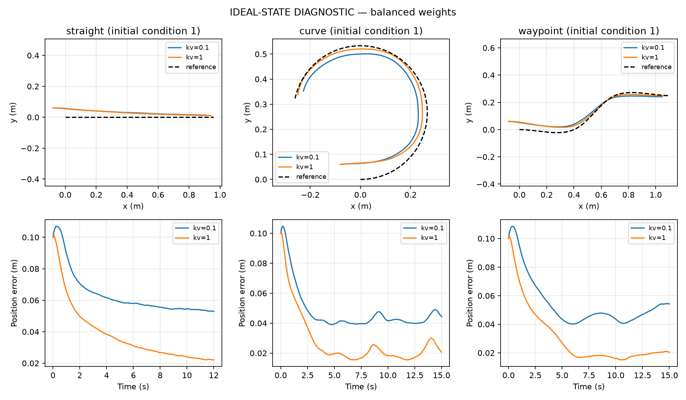
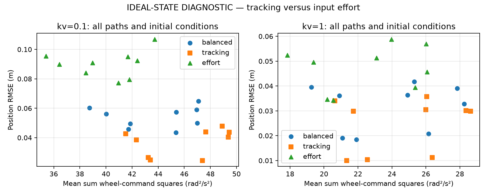
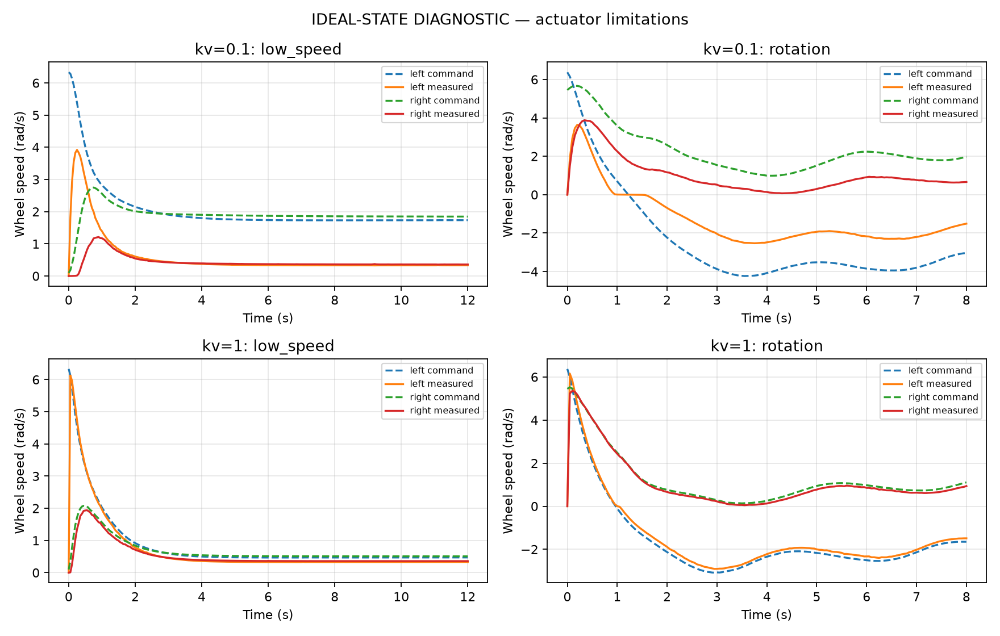

# Part D executed results — IDEAL-STATE DIAGNOSTIC ONLY

Ground-truth pose feeds the controller in these tests. No estimated-state results or final navigation/docking claims.

Metrics include the complete tracking interval, initial transients and the final endpoint sample. Each aggregate averages nine runs (three paths × three initial conditions).

| kv | Weights | Mean position RMSE (m) | Mean heading RMSE (rad) | Mean final position error (m) | Mean wheel² effort / duration (rad²/s²) | Saturated intervals (%) |
|---:|---|---:|---:|---:|---:|---:|
| 0.1 | balanced | 0.054045 | 0.098085 | 0.049856 | 43.786633 | 8.907 |
| 0.1 | tracking | 0.037006 | 0.070228 | 0.026464 | 45.916150 | 17.037 |
| 0.1 | effort | 0.090150 | 0.151361 | 0.095329 | 39.979852 | 0.556 |
| 1 | balanced | 0.031523 | 0.073161 | 0.020587 | 23.958773 | 0.843 |
| 1 | tracking | 0.024626 | 0.055331 | 0.010900 | 24.628558 | 2.546 |
| 1 | effort | 0.047020 | 0.107252 | 0.041154 | 22.494252 | 0.000 |

## All trials

| Trial | Position RMSE (m) | Heading RMSE (rad) | Final position (m) | Final heading (rad, signed) | Saturated (%) |
|---|---:|---:|---:|---:|---:|
| kv0.1_straight_balanced_init0_dt0.002 | 0.049577 | 0.003624 | 0.052541 | -0.001736 | 0.000 |
| kv0.1_straight_balanced_init1_dt0.002 | 0.064863 | 0.070985 | 0.052865 | 0.033423 | 5.833 |
| kv0.1_straight_balanced_init2_dt0.002 | 0.060235 | 0.080104 | 0.053806 | -0.031423 | 0.000 |
| kv0.1_straight_tracking_init0_dt0.002 | 0.026496 | 0.003097 | 0.027170 | 0.001974 | 0.000 |
| kv0.1_straight_tracking_init1_dt0.002 | 0.047775 | 0.071389 | 0.028684 | 0.019317 | 13.333 |
| kv0.1_straight_tracking_init2_dt0.002 | 0.042615 | 0.082397 | 0.028707 | -0.029983 | 1.667 |
| kv0.1_straight_effort_init0_dt0.002 | 0.090921 | 0.003257 | 0.102828 | -0.006870 | 0.000 |
| kv0.1_straight_effort_init1_dt0.002 | 0.106817 | 0.066210 | 0.103691 | 0.040537 | 0.000 |
| kv0.1_straight_effort_init2_dt0.002 | 0.095565 | 0.082117 | 0.104207 | -0.044566 | 0.000 |
| kv0.1_curve_balanced_init0_dt0.002 | 0.043485 | 0.151442 | 0.041539 | 0.107047 | 20.667 |
| kv0.1_curve_balanced_init1_dt0.002 | 0.049832 | 0.179221 | 0.044387 | 0.113621 | 22.333 |
| kv0.1_curve_balanced_init2_dt0.002 | 0.059106 | 0.140291 | 0.040845 | 0.099377 | 26.000 |
| kv0.1_curve_tracking_init0_dt0.002 | 0.024544 | 0.084573 | 0.022979 | 0.018930 | 29.000 |
| kv0.1_curve_tracking_init1_dt0.002 | 0.040416 | 0.131777 | 0.023358 | 0.015390 | 47.000 |
| kv0.1_curve_tracking_init2_dt0.002 | 0.043775 | 0.080630 | 0.022205 | 0.019637 | 41.667 |
| kv0.1_curve_effort_init0_dt0.002 | 0.077187 | 0.264009 | 0.080728 | 0.380466 | 0.000 |
| kv0.1_curve_effort_init1_dt0.002 | 0.079491 | 0.294617 | 0.079913 | 0.370860 | 0.000 |
| kv0.1_curve_effort_init2_dt0.002 | 0.092425 | 0.252538 | 0.081848 | 0.385982 | 5.000 |
| kv0.1_waypoint_balanced_init0_dt0.002 | 0.045876 | 0.074213 | 0.054001 | -0.013335 | 0.000 |
| kv0.1_waypoint_balanced_init1_dt0.002 | 0.057277 | 0.097860 | 0.054331 | -0.009095 | 5.333 |
| kv0.1_waypoint_balanced_init2_dt0.002 | 0.056155 | 0.085023 | 0.054392 | -0.010397 | 0.000 |
| kv0.1_waypoint_tracking_init0_dt0.002 | 0.024907 | 0.041953 | 0.028556 | -0.001796 | 0.000 |
| kv0.1_waypoint_tracking_init1_dt0.002 | 0.044014 | 0.069647 | 0.027573 | -0.001849 | 15.667 |
| kv0.1_waypoint_tracking_init2_dt0.002 | 0.038513 | 0.066593 | 0.028940 | -0.009541 | 5.000 |
| kv0.1_waypoint_effort_init0_dt0.002 | 0.084113 | 0.127593 | 0.101542 | -0.050946 | 0.000 |
| kv0.1_waypoint_effort_init1_dt0.002 | 0.094982 | 0.152927 | 0.101804 | -0.044066 | 0.000 |
| kv0.1_waypoint_effort_init2_dt0.002 | 0.089853 | 0.118979 | 0.101395 | -0.048022 | 0.000 |
| kv0.1_low_speed_balanced_init1_dt0.002 | 0.058615 | 0.132695 | 0.049384 | 0.118516 | 0.000 |
| kv0.1_rotation_balanced_init1_dt0.002 | 0.059664 | 0.216796 | 0.017193 | 0.213876 | 0.000 |
| kv0.1_stationary_balanced_init1_dt0.002 | 0.100008 | 0.199999 | 0.100012 | -0.199998 | 0.000 |
| kv0.1_straight_balanced_init1_dt0.001 | 0.064867 | 0.070597 | 0.053500 | 0.030637 | 5.417 |
| kv0.1_curve_balanced_init1_dt0.001 | 0.049659 | 0.176695 | 0.041255 | 0.098132 | 20.000 |
| kv0.1_waypoint_balanced_init1_dt0.001 | 0.057523 | 0.098545 | 0.054068 | -0.014107 | 6.000 |
| kv1_straight_balanced_init0_dt0.002 | 0.019024 | 0.003896 | 0.020015 | -0.004193 | 0.000 |
| kv1_straight_balanced_init1_dt0.002 | 0.041742 | 0.072311 | 0.022115 | 0.023500 | 2.917 |
| kv1_straight_balanced_init2_dt0.002 | 0.039527 | 0.077743 | 0.023431 | -0.032131 | 0.000 |
| kv1_straight_tracking_init0_dt0.002 | 0.010055 | 0.002964 | 0.010089 | 0.004347 | 0.000 |
| kv1_straight_tracking_init1_dt0.002 | 0.035748 | 0.072915 | 0.013977 | 0.020565 | 6.667 |
| kv1_straight_tracking_init2_dt0.002 | 0.033977 | 0.082482 | 0.013661 | -0.020542 | 1.250 |
| kv1_straight_effort_init0_dt0.002 | 0.034593 | 0.004279 | 0.038986 | -0.003753 | 0.000 |
| kv1_straight_effort_init1_dt0.002 | 0.058767 | 0.068259 | 0.040938 | 0.038982 | 0.000 |
| kv1_straight_effort_init2_dt0.002 | 0.052461 | 0.077428 | 0.042920 | -0.040950 | 0.000 |
| kv1_curve_balanced_init0_dt0.002 | 0.020775 | 0.093570 | 0.018438 | 0.020989 | 0.000 |
| kv1_curve_balanced_init1_dt0.002 | 0.032772 | 0.126678 | 0.020694 | 0.029131 | 2.667 |
| kv1_curve_balanced_init2_dt0.002 | 0.039024 | 0.087009 | 0.019214 | 0.021979 | 0.000 |
| kv1_curve_tracking_init0_dt0.002 | 0.011220 | 0.051909 | 0.009409 | 0.003173 | 0.000 |
| kv1_curve_tracking_init1_dt0.002 | 0.029851 | 0.084744 | 0.010037 | 0.002365 | 7.000 |
| kv1_curve_tracking_init2_dt0.002 | 0.030049 | 0.050409 | 0.009465 | 0.001740 | 2.000 |
| kv1_curve_effort_init0_dt0.002 | 0.039420 | 0.169190 | 0.044709 | 0.173440 | 0.000 |
| kv1_curve_effort_init1_dt0.002 | 0.045732 | 0.201235 | 0.045051 | 0.174620 | 0.000 |
| kv1_curve_effort_init2_dt0.002 | 0.056938 | 0.153191 | 0.043544 | 0.170968 | 0.000 |
| kv1_waypoint_balanced_init0_dt0.002 | 0.018445 | 0.050933 | 0.020771 | 0.003514 | 0.000 |
| kv1_waypoint_balanced_init1_dt0.002 | 0.036333 | 0.076279 | 0.020444 | -0.007241 | 2.000 |
| kv1_waypoint_balanced_init2_dt0.002 | 0.036060 | 0.070026 | 0.020160 | -0.011650 | 0.000 |
| kv1_waypoint_tracking_init0_dt0.002 | 0.010350 | 0.030009 | 0.010728 | 0.006059 | 0.000 |
| kv1_waypoint_tracking_init1_dt0.002 | 0.030477 | 0.060193 | 0.009558 | 0.001864 | 5.667 |
| kv1_waypoint_tracking_init2_dt0.002 | 0.029904 | 0.062356 | 0.011174 | 0.000248 | 0.333 |
| kv1_waypoint_effort_init0_dt0.002 | 0.034281 | 0.086542 | 0.038520 | -0.028269 | 0.000 |
| kv1_waypoint_effort_init1_dt0.002 | 0.051356 | 0.113227 | 0.037671 | -0.027431 | 0.000 |
| kv1_waypoint_effort_init2_dt0.002 | 0.049630 | 0.091916 | 0.038048 | -0.029083 | 0.000 |
| kv1_low_speed_balanced_init1_dt0.002 | 0.048734 | 0.134122 | 0.037764 | 0.118470 | 0.000 |
| kv1_rotation_balanced_init1_dt0.002 | 0.055244 | 0.076654 | 0.017970 | 0.057176 | 0.000 |
| kv1_stationary_balanced_init1_dt0.002 | 0.100008 | 0.199999 | 0.100011 | -0.199998 | 0.000 |
| kv1_straight_balanced_init1_dt0.001 | 0.042445 | 0.072891 | 0.023477 | 0.028612 | 2.917 |
| kv1_curve_balanced_init1_dt0.001 | 0.032715 | 0.125589 | 0.020026 | 0.030475 | 2.667 |
| kv1_waypoint_balanced_init1_dt0.001 | 0.036329 | 0.077648 | 0.020604 | -0.004124 | 2.000 |

## Timestep sensitivity (balanced, initial condition 1)

| kv | Path | Δ position RMSE (fine − coarse, m) | Δ final position error (m) |
|---:|---|---:|---:|
| 0.1 | straight | +0.000004 | +0.000635 |
| 0.1 | curve | -0.000174 | -0.003132 |
| 0.1 | waypoint | +0.000246 | -0.000264 |
| 1 | straight | +0.000703 | +0.001362 |
| 1 | curve | -0.000056 | -0.000669 |
| 1 | waypoint | -0.000004 | +0.000160 |

