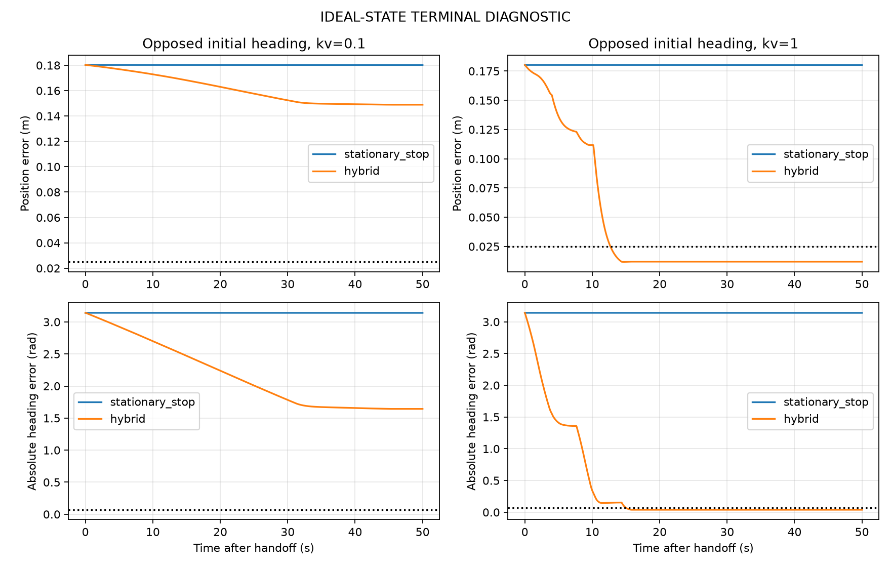
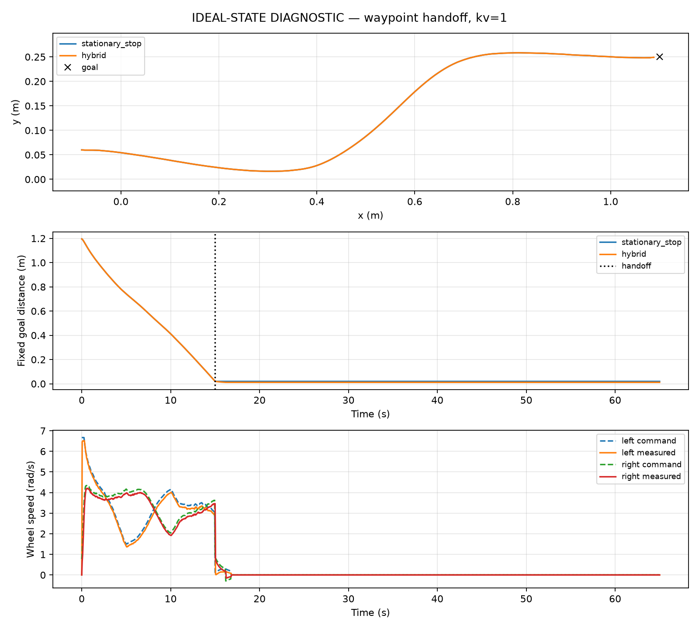

# Staged terminal pose results — IDEAL-STATE DIAGNOSTIC ONLY

Here hybrid denotes the staged revision (0.12 m staging distance, 0.35 rad trigger). No estimated-state integration, obstacle avoidance or ArUco docking is tested. All failures are retained.

| kv | dt (s) | Strategy | Failures / 10 | Mean final position (m) | Mean absolute final heading (rad) | Mean settling among successes (s) | Max position-plane overshoot (m) | Saturated intervals (%) |
|---:|---:|---|---:|---:|---:|---:|---:|---:|
| 0.1 | 0.002 | stationary_stop | 9 / 10 | 0.087988 | 0.866350 | 0.000 | 0.000000 | 0.000 |
| 0.1 | 0.002 | hybrid | 9 / 10 | 0.064426 | 0.913631 | 0.000 | 0.043950 | 0.000 |
| 0.1 | 0.001 | stationary_stop | 9 / 10 | 0.088024 | 0.866770 | 0.000 | 0.000000 | 0.000 |
| 0.1 | 0.001 | hybrid | 9 / 10 | 0.064435 | 0.914115 | 0.000 | 0.043973 | 0.000 |
| 1 | 0.002 | stationary_stop | 7 / 10 | 0.082218 | 0.864754 | 0.067 | 0.000000 | 0.000 |
| 1 | 0.002 | hybrid | 0 / 10 | 0.011873 | 0.031489 | 9.245 | 0.108880 | 0.000 |
| 1 | 0.001 | stationary_stop | 7 / 10 | 0.082367 | 0.864947 | 0.067 | 0.000000 | 0.000 |
| 1 | 0.001 | hybrid | 0 / 10 | 0.012157 | 0.031523 | 9.180 | 0.108873 | 0.000 |

Settling requires position ≤0.025 m, absolute heading ≤0.07 rad, observed speed ≤0.008 m/s and yaw rate ≤0.04 rad/s continuously to the horizon, for at least 2 s. Unsettled trials fail. Means include all ten scenarios; settling means exclude failures.

| Trial | Final position (m) | Final heading (rad) | Settling (s) | Failed | Mode switches | Final mode |
|---|---:|---:|---:|---|---:|---|
| ahead_kv0.1_dt0.002_stationary_stop | 0.200067 | 0.000646 | — | True | 0 | stationary_stop |
| ahead_kv0.1_dt0.002_hybrid | 0.039394 | 0.000193 | — | True | 1 | fault |
| behind_kv0.1_dt0.002_stationary_stop | 0.149933 | 0.000646 | — | True | 0 | stationary_stop |
| behind_kv0.1_dt0.002_hybrid | 0.117849 | 2.020811 | — | True | 1 | fault |
| lateral_kv0.1_dt0.002_stationary_stop | 0.150046 | 1.000646 | — | True | 0 | stationary_stop |
| lateral_kv0.1_dt0.002_hybrid | 0.150601 | 1.994653 | — | True | 1 | fault |
| opposed_kv0.1_dt0.002_stationary_stop | 0.180211 | -3.140947 | — | True | 0 | stationary_stop |
| opposed_kv0.1_dt0.002_hybrid | 0.148904 | -1.643327 | — | True | 1 | fault |
| heading_only_kv0.1_dt0.002_stationary_stop | 0.000070 | -1.199354 | — | True | 0 | stationary_stop |
| heading_only_kv0.1_dt0.002_hybrid | 0.023715 | -0.161369 | — | True | 1 | fault |
| wrap_kv0.1_dt0.002_stationary_stop | 0.084885 | 3.122239 | — | True | 0 | stationary_stop |
| wrap_kv0.1_dt0.002_hybrid | 0.077720 | -2.825113 | — | True | 2 | fault |
| near_kv0.1_dt0.002_stationary_stop | 0.015743 | 0.150646 | — | True | 0 | stationary_stop |
| near_kv0.1_dt0.002_hybrid | 0.016067 | 0.164703 | — | True | 2 | fault |
| at_goal_kv0.1_dt0.002_stationary_stop | 0.000070 | 0.000646 | 0.00 | False | 0 | stationary_stop |
| at_goal_kv0.1_dt0.002_hybrid | 0.000070 | 0.000646 | 0.00 | False | 1 | stop |
| handoff_straight_kv0.1_dt0.002_stationary_stop | 0.048742 | 0.032003 | — | True | 0 | stationary_stop |
| handoff_straight_kv0.1_dt0.002_hybrid | 0.035746 | 0.193149 | — | True | 2 | fault |
| handoff_waypoint_kv0.1_dt0.002_stationary_stop | 0.050117 | -0.015723 | — | True | 0 | stationary_stop |
| handoff_waypoint_kv0.1_dt0.002_hybrid | 0.034194 | -0.132342 | — | True | 2 | fault |
| ahead_kv0.1_dt0.001_stationary_stop | 0.200065 | 0.000646 | — | True | 0 | stationary_stop |
| ahead_kv0.1_dt0.001_hybrid | 0.039391 | 0.000340 | — | True | 1 | fault |
| behind_kv0.1_dt0.001_stationary_stop | 0.149935 | 0.000646 | — | True | 0 | stationary_stop |
| behind_kv0.1_dt0.001_hybrid | 0.117853 | 2.018832 | — | True | 1 | fault |
| lateral_kv0.1_dt0.001_stationary_stop | 0.150044 | 1.000646 | — | True | 0 | stationary_stop |
| lateral_kv0.1_dt0.001_hybrid | 0.150601 | 1.994503 | — | True | 1 | fault |
| opposed_kv0.1_dt0.001_stationary_stop | 0.180213 | -3.140947 | — | True | 0 | stationary_stop |
| opposed_kv0.1_dt0.001_hybrid | 0.148875 | -1.643589 | — | True | 1 | fault |
| heading_only_kv0.1_dt0.001_stationary_stop | 0.000068 | -1.199354 | — | True | 0 | stationary_stop |
| heading_only_kv0.1_dt0.001_hybrid | 0.023728 | -0.161370 | — | True | 1 | fault |
| wrap_kv0.1_dt0.001_stationary_stop | 0.084883 | 3.122239 | — | True | 0 | stationary_stop |
| wrap_kv0.1_dt0.001_hybrid | 0.077713 | -2.825779 | — | True | 2 | fault |
| near_kv0.1_dt0.001_stationary_stop | 0.015745 | 0.150646 | — | True | 0 | stationary_stop |
| near_kv0.1_dt0.001_hybrid | 0.016058 | 0.165177 | — | True | 2 | fault |
| at_goal_kv0.1_dt0.001_stationary_stop | 0.000068 | 0.000646 | 0.00 | False | 0 | stationary_stop |
| at_goal_kv0.1_dt0.001_hybrid | 0.000068 | 0.000646 | 0.00 | False | 1 | stop |
| handoff_straight_kv0.1_dt0.001_stationary_stop | 0.049350 | 0.030084 | — | True | 0 | stationary_stop |
| handoff_straight_kv0.1_dt0.001_hybrid | 0.036320 | 0.211905 | — | True | 2 | fault |
| handoff_waypoint_kv0.1_dt0.001_stationary_stop | 0.049875 | -0.021846 | — | True | 0 | stationary_stop |
| handoff_waypoint_kv0.1_dt0.001_hybrid | 0.033748 | -0.119009 | — | True | 1 | fault |
| ahead_kv1_dt0.002_stationary_stop | 0.200062 | 0.000577 | — | True | 0 | stationary_stop |
| ahead_kv1_dt0.002_hybrid | 0.011787 | -0.001137 | 4.85 | False | 2 | stop |
| behind_kv1_dt0.002_stationary_stop | 0.149938 | 0.000577 | — | True | 0 | stationary_stop |
| behind_kv1_dt0.002_hybrid | 0.011854 | 0.039301 | 24.95 | False | 6 | stop |
| lateral_kv1_dt0.002_stationary_stop | 0.150042 | 1.000577 | — | True | 0 | stationary_stop |
| lateral_kv1_dt0.002_hybrid | 0.012262 | 0.039204 | 18.00 | False | 6 | stop |
| opposed_kv1_dt0.002_stationary_stop | 0.180216 | -3.141016 | — | True | 0 | stationary_stop |
| opposed_kv1_dt0.002_hybrid | 0.011990 | -0.039065 | 15.40 | False | 6 | stop |
| heading_only_kv1_dt0.002_stationary_stop | 0.000064 | -1.199423 | — | True | 0 | stationary_stop |
| heading_only_kv1_dt0.002_hybrid | 0.016161 | -0.038934 | 3.55 | False | 2 | stop |
| wrap_kv1_dt0.002_stationary_stop | 0.084883 | 3.122169 | — | True | 0 | stationary_stop |
| wrap_kv1_dt0.002_hybrid | 0.011823 | -0.039386 | 14.80 | False | 6 | stop |
| near_kv1_dt0.002_stationary_stop | 0.015748 | 0.150577 | — | True | 0 | stationary_stop |
| near_kv1_dt0.002_hybrid | 0.017449 | 0.038506 | 6.55 | False | 3 | stop |
| at_goal_kv1_dt0.002_stationary_stop | 0.000064 | 0.000577 | 0.00 | False | 0 | stationary_stop |
| at_goal_kv1_dt0.002_hybrid | 0.000064 | 0.000577 | 0.00 | False | 1 | stop |
| handoff_straight_kv1_dt0.002_stationary_stop | 0.021494 | 0.024048 | 0.10 | False | 0 | stationary_stop |
| handoff_straight_kv1_dt0.002_hybrid | 0.013471 | 0.039137 | 2.90 | False | 4 | stop |
| handoff_waypoint_kv1_dt0.002_stationary_stop | 0.019672 | -0.008002 | 0.10 | False | 0 | stationary_stop |
| handoff_waypoint_kv1_dt0.002_hybrid | 0.011873 | -0.039643 | 1.45 | False | 3 | stop |
| ahead_kv1_dt0.001_stationary_stop | 0.200060 | 0.000577 | — | True | 0 | stationary_stop |
| ahead_kv1_dt0.001_hybrid | 0.011897 | -0.001687 | 4.85 | False | 2 | stop |
| behind_kv1_dt0.001_stationary_stop | 0.149940 | 0.000577 | — | True | 0 | stationary_stop |
| behind_kv1_dt0.001_hybrid | 0.011958 | 0.039343 | 24.70 | False | 6 | stop |
| lateral_kv1_dt0.001_stationary_stop | 0.150040 | 1.000577 | — | True | 0 | stationary_stop |
| lateral_kv1_dt0.001_hybrid | 0.012548 | 0.038305 | 17.95 | False | 6 | stop |
| opposed_kv1_dt0.001_stationary_stop | 0.180218 | -3.141016 | — | True | 0 | stationary_stop |
| opposed_kv1_dt0.001_hybrid | 0.011935 | -0.039496 | 15.30 | False | 6 | stop |
| heading_only_kv1_dt0.001_stationary_stop | 0.000062 | -1.199423 | — | True | 0 | stationary_stop |
| heading_only_kv1_dt0.001_hybrid | 0.017842 | -0.038743 | 3.60 | False | 2 | stop |
| wrap_kv1_dt0.001_stationary_stop | 0.084881 | 3.122170 | — | True | 0 | stationary_stop |
| wrap_kv1_dt0.001_hybrid | 0.011964 | -0.039196 | 14.90 | False | 5 | stop |
| near_kv1_dt0.001_stationary_stop | 0.015750 | 0.150577 | — | True | 0 | stationary_stop |
| near_kv1_dt0.001_hybrid | 0.017195 | 0.038590 | 7.05 | False | 3 | stop |
| at_goal_kv1_dt0.001_stationary_stop | 0.000062 | 0.000577 | 0.00 | False | 0 | stationary_stop |
| at_goal_kv1_dt0.001_hybrid | 0.000062 | 0.000577 | 0.00 | False | 1 | stop |
| handoff_straight_kv1_dt0.001_stationary_stop | 0.022825 | 0.028775 | 0.10 | False | 0 | stationary_stop |
| handoff_straight_kv1_dt0.001_hybrid | 0.014267 | 0.039835 | 3.10 | False | 4 | stop |
| handoff_waypoint_kv1_dt0.001_stationary_stop | 0.019830 | -0.005204 | 0.10 | False | 0 | stationary_stop |
| handoff_waypoint_kv1_dt0.001_hybrid | 0.011906 | -0.039458 | 0.35 | False | 2 | stop |

